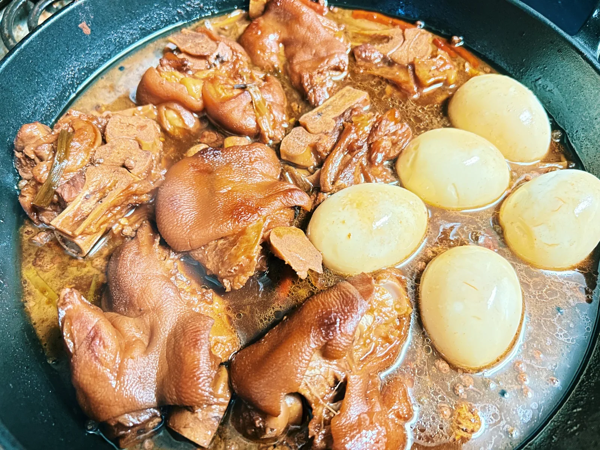

我是一个把家里塞得满满的霍比特人

> 木の葉かと思へば鳥や冬仕度
>  _（以为是落叶，原来是鸟，也在准备过冬。）_
>  —— 下坂速穂
{: .diary-epigraph}

<h3 class="diary-entry-date">11月1日（日）</h3>
之前买的珐琅锅昨天送到了。我买了一个3.5-Qt的Braiser锅，等送到后发现硕大无比。我自言自语道：这将是我家最大的锅！

今天就用新锅卤猪蹄，先将猪蹄焯水，再用凉水冲洗后，放入Braiser锅，炖了2个半小时。这边煮了几个鸡蛋，关火后放入卤汁中。

煮好的猪蹄香甜软烂，我一口气吃掉了一大半！

月初第一天，不像月末一样，要守着仅剩的一点点预算过日子。于是我在MUJI上买了些厨房家用物品，Amazon上买了一个摩卡壶，Harney & Sons的茶叶也囤了一堆。

年末啦，我是一个把家里塞得满满的霍比特人！

<figure style="text-align: center;">
  
  <figcaption>卤猪蹄</figcaption>
</figure>

<h3 class="diary-entry-date">11月3日（火）</h3>
进入11月，工作的节奏稍稍放缓了一些，于是有时间（摸鱼）看书。最近一直沉迷于一本描写金帐汗国的历史书，《欧亚大陆的枢纽：金帐汗国与草原秩序》，已经看了一半多，就快看完，恋恋不舍。这个时期的蒙古帝国，也正是欧洲中世纪时期，从蒙古帝国的角度讲述这段历史更加有趣。

比如书中提到一位佛罗伦萨金融公司巴迪商行的商人，弗朗切斯科·裴哥罗梯（Francesco Pegolotti）于1335-1343年的某段时间，根据自己的经验和传闻，为商人们撰写了一本旅行手册，帮助商人们从欧洲（威尼斯）进入金帐汗国，前往中国。

> 若要从威尼斯前往中国的大汗之城做生意，您可以遵循以下建议。首先，您最好留长胡须。这样一旦到达蒙古治下，您就会像伊斯兰商人一样融入当地人之中。其次，您可以在商品之外带上几百根银条，用于在需要时交换当地货币。最后，谨记千万不要选择南方的路线。

因为当时南方的路线是伊利汗国控制，伊利汗国当时时局不稳，对于商人和旅人来说，就有很多的危险和隐患。所以裴哥罗梯建议走北方之路：

> 前往中国的最佳路线是北方之路。这条路线的起点在顿河入海口处的港口塔纳。您需要在那里雇用一名翻译，我建议您挑选一名出色的，无论需要花费多少钱。您还需要至少两名会说钦察语的男仆，钦察语是西亚地区使用最广泛的语言。除了男仆，您也可以雇女性，但记住同样要选择会说钦察语的。从塔纳出发，下一站是哈只·答剌罕，此地是伏尔加河流入里海的入海口。这段旅程若乘坐马车需要十至十二天，如果乘坐牛车则需要二十五天。您需要备上干咸鱼和面粉供路途中食用，但不用携带肉类。肉食在沿途随处可得。

裴哥罗梯还写道旅途的费用和安全：

> 在北方之路的路途中，您所需要的运费并不太多。如果您的商品价值不超过两万五千金弗罗林，您只需要支付六十至八十根银锭就能到达汗八里（北京），回程时的花销可能更少。您一定要购入丝绸之类体积小巧、易于携带的奢侈品，以便回程时用其中的一部分换取银子。这是因为在中国时，您需要将银锭换成纸币使用。元朝只接受使用纸币进行交易。在您回程时，您可以在玉龙杰赤再次停驻，将丝绸重新换成银锭。在旅途中您无须防备窃贼——蒙古律法保护外国商人，会严惩抢劫罪行。但为了确保律法站在您这一边，某些预防措施还是必要的。其中最重要的是，不要在没有生意伙伴的情况下冒险进入蒙古领土。如果您死在旅途之中，您带来的所有东西都将归大汗所有——除非您有一个可以领走您货物的同伴。另外，一定要确保您能得到关于蒙古的最新消息，因为在大汗缺位（或者数位汗王在为权力相搏）的情况下，踏入蒙古领土对于外邦人而言非常危险。而在其他时刻，北方之路无论昼夜皆十分安全。

<h3 class="diary-entry-date">11月4日（水）</h3>
昨天晚上美国中期选举开票，今天看BBC的访谈听到一个笑话：

Trump didn't bring regime change to Iran, but he's brought it to Texas.

今天是久违的蓝天。

<h3 class="diary-entry-date">11月6日（金）</h3>
一大早要开会。早上匆忙爬起来，随手拿了一包挂耳咖啡，装上午饭便当就出门。

时节已经是深秋，阴天，植被萧瑟。我套了一件墨绿色的厚毛衣，穿了一条黑色灯芯绒裤，脚上一双黑色厚底皮鞋（这样显得我有168cm！），拿起日常上班背的，在“莎士比亚书店”买的帆布包。推开门，感到一阵凉意：我需要一件大衣。

周五，又开了一上午的会，喝了挂耳咖啡依然困乏，于是开始摸鱼。联系在多伦多的朋友，约了在多伦多的网友，定了总去剪头发的理发店，找了一家餐馆订了座和家人去吃漂亮饭。

朋友可能会在平安夜生宝宝。 
我说：这样就和相葉雅紀同一天生日啊！ 
（我们老杰尼斯粉是这样的。）

一切都准备就绪，心已经飞到年末圣诞节啦！

<h3 class="diary-entry-date">11月7日（土）</h3>
今天立冬。想到俵万智的一首短歌：

> 「寒いね」と話しかければ「寒いね」と答える人のいるあたたかさ
>  _（我说一句‘好冷啊’，有人回应我‘好冷啊’，这样的温暖。）_

前两天买了「俳句歳時記 冬（第五版）」这本书，立冬也是俳句的季节语。书里选：

> 立冬のことに草木のかがやける
>  _（立冬时节，草木格外熠熠生辉）_
>  —— 沢木欣一

> 灯を消して匂う本棚冬に入る
>  _（灯灭之后，书香暗暗浮动，冬意悄然而至。）_
>  —— 渋川京子

在家用空气炸锅烤了honeynut squash，撒了盐胡椒和肉桂粉，出锅后软绵甜糯。降温了，是点起蜡烛的时候啦。

<h3 class="diary-entry-date">11月8日（日）</h3>
变成了《哈尔的移动城堡》里哈尔的一天。从心中冒出各种黑暗的精灵，它们笼罩着我，我的身体开始融化，渗出粘稠的液体，沮丧无力。窗外明媚的秋日，在我眼中是一片黑白，暗淡无光。

我被不知名的悲伤包裹着，无法起身，勉强爬起来吃了一包泡面又继续睡去。再次醒过来已经天黑。看着没有做的家务，想到还没有准备明天的午饭，我试图打起精神做点什么。但现在能做的只有最基础的self-care。晕晕乎乎的，我用微波炉加热了米饭，烧水冲了一包味噌汤，配一盒纳豆。吃完接着睡觉。

<h3 class="diary-entry-date">11月10日（火）</h3>
早上出门的时候，一呼吸，能看到淡淡的白色哈气。不愧是立冬了。

周末看一个节目里知道，在南极，哈气并不是白色的，因为南极空气干净，水蒸气在空气中没有尘埃可以附着，于是就看不见。除非气温低于零下40度，哈气立刻冻成冰晶，才会呈白色。

傍晚下班时，太阳沉下去，映照着天边红彤彤的。

晚上用空气炸锅随便烤了几块cod鱼块。翠宏烧烤料真香。

<h3 class="diary-entry-date">11月11日（水）</h3>
一边看节目一边心不在焉地和朋友聊天，结果回的话前言不搭后语。

<ul class="conversation-log diary-conversation" aria-label="对话记录">
  <li class="conversation-turn">朋友弱智！</li>
  <li class="conversation-turn">我。。。</li>
  <li class="conversation-note">（半分钟后反应过来）</li>
  <li class="conversation-turn">我凭什么要被你这么说！我不接受！不许这么说我！</li>
  <li class="conversation-turn">朋友微笑emoji，开始说别的。</li>
  <li class="conversation-note">（我，生气，不搭理。。。10分钟后）</li>
  <li class="conversation-turn">我哼。开始说别的。</li>
  <li class="conversation-note">（朋友不见了！）</li>
</ul>

我内心：给你台阶了居然不接，不知好歹！最好立刻安抚我，否则就会变成一场战争！战争！战争！

结果是朋友去忙了，回来后逗我开心了，战争没打起来。

めでたし，めでたし。

<h3 class="diary-entry-date">11月12日（木）</h3>
秋末冬初有两副面孔，细密绵长的秋雨，高远晴朗的长空。早晨出门，大风，树木摇曳着，树叶几乎都变红变黄，在太阳下，闪烁着金灿灿的光。

昨天放假，终于把秋冬的衣裤拿去干洗，又买了食材回来做了三文鱼蘑菇焖饭。然而因为料太多，电饭煲焖出来的饭夹生。我只好把饭倒入铸铁锅中，加点水，继续焖一会儿。饭是熟了，但软塌塌的，勉强能吃。

忽然下沉的心情，偶尔失败的料理，都是日常生活的一部分，还能补救，勉强能吃，这样想着，我就不会恐慌和惧怕它了。

今天早上炒了个鸡蛋，放在用黄油煎了的面包片上，作为简单的早餐。刚拿起来咬了一口，面包从手里滑落，炒鸡蛋散了一桌子。于是我拍了照片发给朋友：

2分钟前↓ 
完美的早餐.jpg 
2分钟后↓ 
一片狼藉.jpg

朋友大笑。

能用自己的狼狈逗别人发笑，我今天的心情也是，晴朗的长空。
